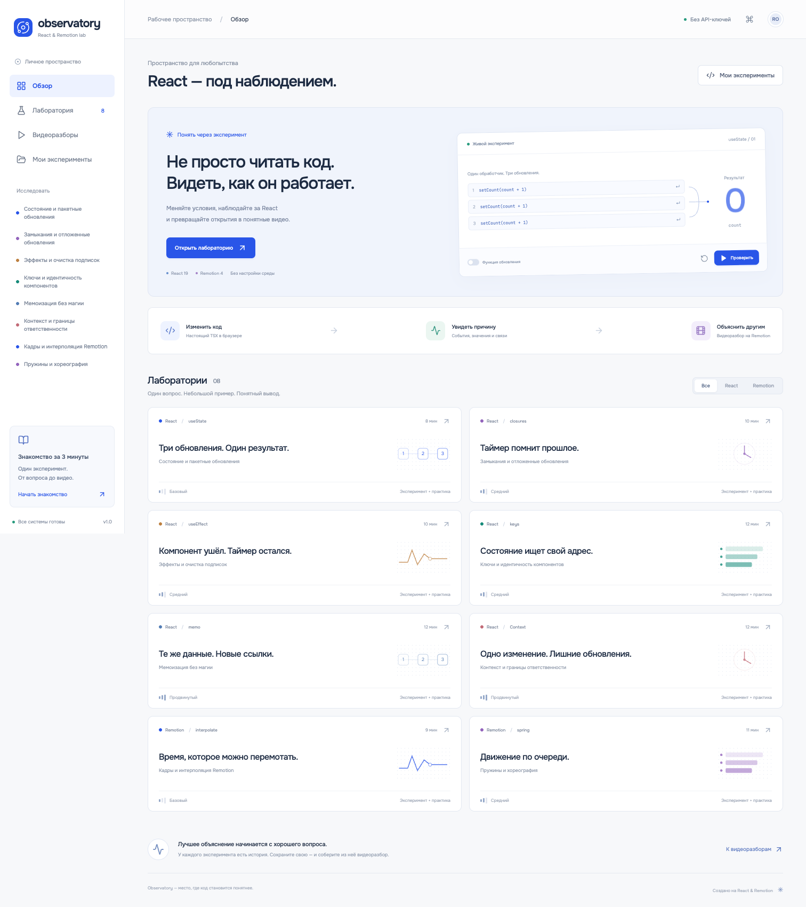
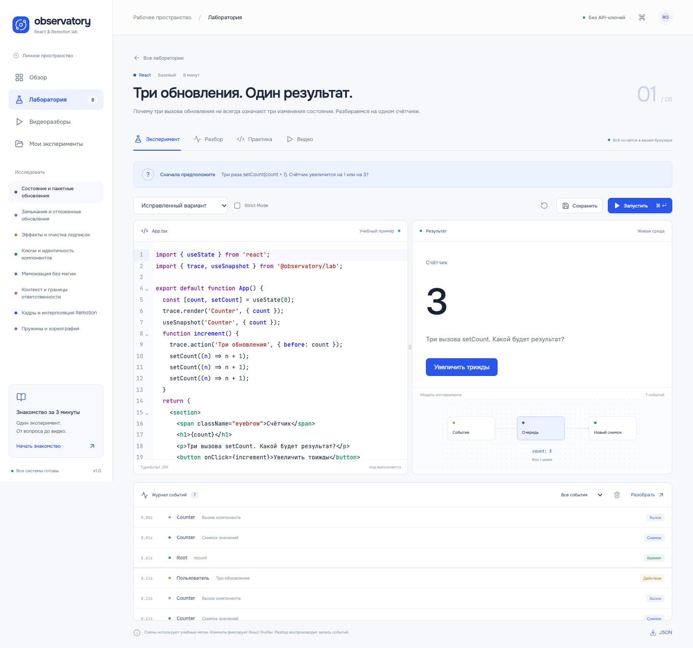
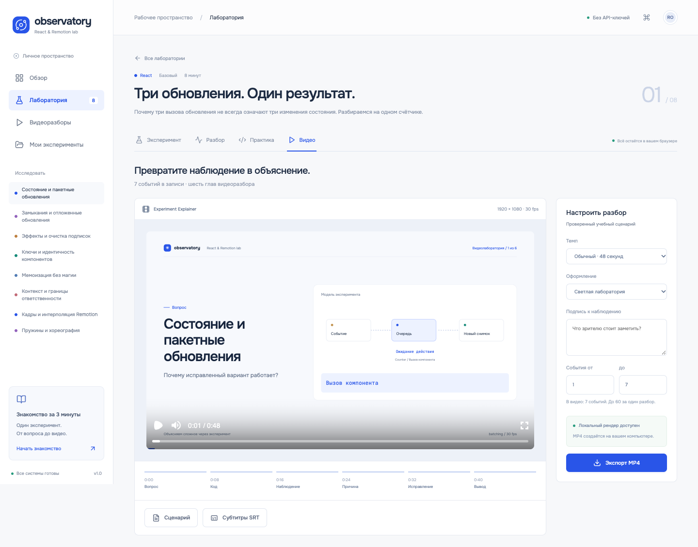

# React Observatory

**Интерактивная лаборатория React и Remotion: изменить код, увидеть причину, объяснить другим.**

Observatory объединяет живой TSX-редактор, запись событий React, задания с проверкой поведения и создание анимированных видеоразборов. Это самостоятельный образовательный продукт: пользователь исследует конкретную гипотезу и проверяет её небольшим экспериментом.



## Запуск за минуту

Требуется **Node.js 22.12+ и npm**. Проверено на Node.js 24 / macOS Apple Silicon.

```bash
npm ci
npm run dev
```

Открыть **http://127.0.0.1:5174**. Команда собирает локальную среду исполнения, запускает интерфейс и сервер рендера. API-ключи и аккаунты не нужны. При первом MP4-экспорте Remotion скачивает Chrome Headless Shell; после подготовки зависимостей, шрифтов и браузера внешние сервисы для работы не нужны.

Готовое веб-демо: [React Observatory](https://react-observatory-20261016.peachylotus4.chatgpt.site). В нём работают лаборатории, редактор, запись, практика, предпросмотр и готовые видео. Новый MP4 создаётся в полной локальной версии.

## Один законченный сценарий

1. Открыть лабораторию «Три обновления. Один результат.» и предсказать результат.
2. Нажать «Увеличить трижды»: три вызова передают одно значение из снимка состояния.
3. Открыть «Разбор», выбрать событие и увидеть данные рядом со строкой кода.
4. Вернуться, выбрать исправленный вариант и запустить функциональные обновления.
5. Подтвердить изменение на 3 в разделе «Практика».
6. Сохранить эксперимент или собрать его видеоразбор с Remotion.



## Восемь лабораторий

| Лаборатория | Наблюдаемое поведение |
| --- | --- |
| Состояние и пакетные обновления | Три обновления из снимка против очереди функций |
| Замыкания | Устаревшее значение внутри таймера |
| Эффекты | Подписка, размонтирование и симметричная очистка |
| Ключи | Сохранение введённого текста при перестановке задач |
| Мемоизация | Реальные вызовы дочернего компонента при нестабильных props |
| Контекст | Область обновлений и разделение независимых данных |
| Кадры Remotion | Значение прозрачности на определённом кадре |
| Пружины | Задержка через локальное время анимации |

У каждой есть исходный и исправленный код, объяснение, два вопроса, проверка результата взаимодействий и готовое видео. В `examples/` лежат шестнадцать переносимых записей — обе версии каждой лаборатории.

## Возможности

- Настоящий запуск редактируемого `App.tsx` в отдельном iframe.
- CodeMirror: подсветка TSX, номера строк, поиск, сворачивание и `⌘/Ctrl+Enter`.
- Изменение ширины редактора мышью и клавиатурой.
- Переключение development Strict Mode, ошибки компиляции и восстановления среды.
- События действий, вызовов, эффектов, очистки, снимков значений и коммитов Profiler.
- Связь явных учебных меток со строками исходного кода.
- Пошаговый просмотр записи и фильтрация журнала.
- Проверка поведения по записанным действиям и состояниям, а не по тексту решения.
- Независимые черновики, сохранённые эксперименты и ответы в IndexedDB.
- JSON-импорт и экспорт с версией, валидацией и согласованным ограничением 8 МБ.
- Одна Remotion-композиция для Player и MP4; сценарий Markdown и субтитры SRT.
- Очередь рендера, прогресс, отмена и восстановление последнего экспорта при возвращении во вкладку.
- Адаптивный интерфейс, клавиатурный фокус и reduced motion.

## Видеоматериалы

`public/videos/` содержит восемь настоящих MP4/H.264, 1920×1080, 30 fps, по 48 секунд. Каждый показывает исходный эксперимент и отдельно контрольную запись исправления. Данные получены автоматизированными действиями в реальном браузере; проверка соответствия записей включена в тесты.

`observatory-demo.mp4` — минутный обзор самого продукта, собранный в Remotion из шести настоящих экранов приложения. Все видео без озвучки. Сценарий для живого объяснения — в [руководстве демонстрации](docs/demo-guide.md).



## Команды

```bash
npm run dev           # Интерфейс :5174 + локальный рендер :3002
npm run build         # Полная production-сборка
npm start             # Полный продукт на :3002 после build
npm run build:demo    # Статическое демо с hash-навигацией
npm run preview       # Предпросмотр сборки на :4174
npm run studio        # Оригинальная Remotion Studio
npm run render:all    # Восемь учебных MP4
npm run render:demo   # Минутный обзор продукта
npm test              # Контракты, компилятор, данные, проверки и очередь
npm run test:e2e      # Браузерные сценарии (dev должен быть запущен)
npm run typecheck     # TypeScript
npm run format:check  # Проверка форматирования
```

Для E2E нужен установленный Google Chrome. Видео рендерятся независимо от Vite. Повторный сбор учебных записей: `OBS_CAPTURE=1 npm run test:e2e`, затем `npx tsx scripts/collect-recordings.ts`. Подготовка форматированных исходников из учебных определений: `npm run prepare:labs`.

## Архитектура

React 19 · TypeScript · Remotion 4 · Vite · CodeMirror 6 · Babel · Zod · IndexedDB · Express · Onest · JetBrains Mono.

Модель, исполнение кода, интерфейс и видеокомпозиции разделены. Babel работает в Worker; iframe получает предварительно собранные библиотеки. На сервер рендера передаются только данные `VideoBrief`, пользовательский TSX сервер не выполняет. Тяжёлые страницы и компилятор загружаются отдельно от обзора.

Подробности: [архитектура](docs/architecture.md), [проверки](docs/verification.md), [показ работодателю](docs/demo-guide.md).

## Границы версии

Это индивидуальная лаборатория с локальным хранением. Перенос между браузерами выполняется через JSON. Аккаунтов, совместного редактирования, облачной очереди, записи микрофона и автоматического анализа произвольного кода нет.

Редактор компилирует TypeScript-синтаксис, но не выполняет полную проверку типов внутри пользовательского файла. Доступны встроенные `react`, `react/jsx-runtime`, `react-dom/client`, `remotion`, `@remotion/player` и `@observatory/lab`; установка произвольных npm-пакетов в редакторе не предусмотрена.

Дерево на схеме — учебная модель с явно заданными областями, не внутреннее дерево Fiber. Пошаговый разбор воспроизводит события и снимки; состояние произвольного React-приложения он не восстанавливает. Контрольные записи в готовых уроках обозначены отдельно.

Запись ограничена 1000 событиями и общим размером. Обычные циклы и функции получают временной бюджет; синхронные операции внутри сторонних библиотек не прерываются этим механизмом.

Сервер допускает один активный рендер и три ожидающих. Статусы находятся в памяти и сбрасываются после перезапуска; файлы завершённых заданий очищаются через 24 часа работы процесса. Сервер привязан к loopback. Статическое демо явно отключает новые MP4-экспорты.

Исходный код проекта: MIT. Зависимости, шрифты и Remotion используются на условиях их собственных лицензий.
